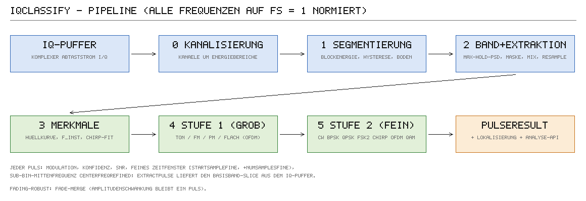
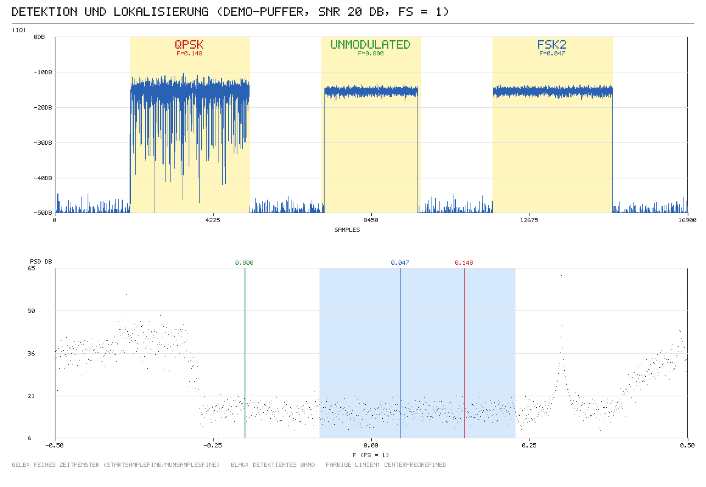
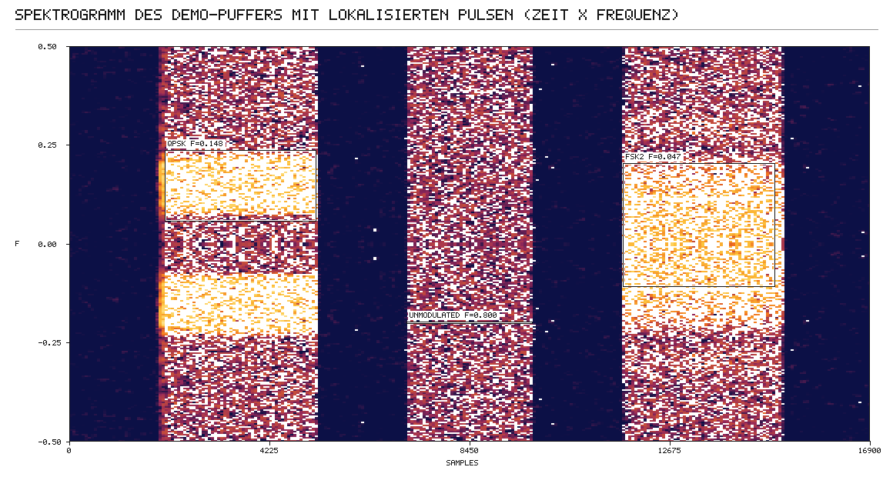

# IQClassify

Modulationsklassifikation von Pulsen in IQ-Signalen (C++17, statische
Bibliothek).

IQClassify durchsucht einen komplexen Abtaststrom (I/Q, Basisband) nach
Pulsen, trennt gleichzeitig auftretende Pulse in Frequenz und Zeit und
klassifiziert die Modulationsart jedes Pulses in zwei Stufen:

- Stufe 1 (grob): Ton, Frequenzmodulation, Phasenmodulation, flaechiges
  Signal.
- Stufe 2 (fein): Unmodulated (CW), BPSK, QPSK, FSK2, Chirp, OFDM,
  QAM16, QAM64, QAM256, FrankCode (polyphase Frank-Code, Radar: Treppe der
  Momentanfrequenz mit M Stufen; Analyse via `analyzeFrank`: Ordnung M,
  Code-Laenge M^2, Chip-Rate, Code-Phasen).

## Merkmale

- Spektrale Kanalisierung als erster Pipelineschritt: die Kanaele sind nicht
  gleichverteilt, sondern legen sich um die detektierten Energiebereiche im
  Spektrum (adaptiv, je Bereich ein Kanal um dessen Energieschwerpunkt).
  `Channelizer` extrahiert/mischt/resamplet jeden Kanal einzeln
  (`channelize`/`extract`/`resample`); `classify` arbeitet intern pro Kanal
  (`channelize` in `ClassifierConfig`, Resampling via `channelDecimate`).
- Keine Abhaengigkeiten ausser PocketFFT (header-only, vendored unter
  `third_party/pocketfft/`).
- Interne Rechnung in Doppelpraezision; Eingabe als `float` oder `double`.
- Mehrere Pulse pro Puffer: zeitlich getrennt und gleichzeitig in
  verschiedenen Frequenzbaendern.
- Lokalisierung: jeder detektierte Puls wird mit samplegenauer Zeitlage
  (`startSampleFine`/`numSamplesFine`) und Sub-Bin-Mittenfrequenz
  (`centerFreqRefined`) ausgegeben; `extractPulse` liefert den Puls als
  Basisband-Slice direkt aus dem IQ-Puffer (Wiederfinden im Signal).
- Low-SNR: Detektion bis herunter zu ~2 dB SNR (Default `minSnrDb` = 2 dB;
  Band-Bruecke `bandBridgeDb` verschmilzt Rauschluecken in schwachen
  Breitbandsignalen). Reine Rauschpuffer liefern weiterhin keine Pulse.
- Analyse-API je Puls: `synchronizePsk` synchronisiert einen PSK-Puls
  phasenrichtig auf den Pulsanfang (Traegerfrequenz/-phase, Symboltakt,
  derotierte Symbole — Batch-Schaetzung, kein Einschwingvorgang),
  `analyzeChirp` liefert alle Parameter eines Chirp-Pulses (Start-/End-
  frequenz, Hub, Steigung, Richtung, r²), `extractSymbols` stellt die
  Symbol-Schnittstelle fuer PSK und FSK2 bereit.
- Klassenkapselung: eine Fassade (`ModulationClassifier`), alle
  Schwellwerte konfigurierbar (`ClassifierConfig`).
- Deterministische Testsuite ohne externes Testframework: 136 Szenarien
  aus der Qualitaetsmatrix (SNR-Raster, Oversampling, Frequenzlagen,
  Chirp-Varianten, Pulslaengen, Mehrpuls, Seed-Streuung) plus
  Haertungsfaelle (Nullzeiger, leere und NaN-beladene Eingaben,
  Dropouts im Puls).
- Robust gegen Amplitudenschwankungen (Fading): Ein Puls mit schwankender
  Amplitude bleibt durch Fade-Merge ein Puls (solange der Einbruch nicht
  bis auf den Rauschboden faellt), inkl. korrekter Klassifikation und
  Lokalisierung.
- Haertung der Eingabepfade: NaN/Inf-Samples verhalten sich wie
  Schweigephasen und vergiften weder FFT-Fenster noch Statistiken
  (siehe docs/METHODOLOGY.md).

## Bauen mit CMake

    cmake -B build -DCMAKE_BUILD_TYPE=Release
    cmake --build build
    ctest --test-dir build        # Testsuite (Option IQCLASSIFY_BUILD_TESTS)

## Bauen mit qmake

    qmake IQClassify.pro
    make                          # erzeugt libIQClassify.a

Testsuite:

    cd tests
    qmake IQClassifyTests.pro && make && ./iqclassify_tests

Einbindung in ein qmake-Konsumentenprojekt:

    include(IQClassify.pri)

## Verwendung

    #include "iqclassify/iqclassify.hpp"

    iqclassify::ClassifierConfig cfg;              // Optionen/Schwellwerte
    iqclassify::ModulationClassifier clf(cfg);
    std::vector<std::complex<float>> iq = /* ... */;
    for (const auto& pulse : clf.classifyF(iq.data(), iq.size())) {
        // pulse.modulation, pulse.confidence, pulse.centerFreqNorm, ...
        // Puls zeitlich/frequenztechnisch wiederfinden (fs = 1 normiert):
        //   t0 = pulse.startSampleFine, len = pulse.numSamplesFine,
        //   f0 = pulse.centerFreqRefined
        auto slice = clf.extractPulseF(iq.data(), iq.size(), pulse);
        // slice[k] == iq[pulse.startSampleFine + k], auf f0 verschoben
    }

    // Spektrale Kanalisierung: Kanaele um die Energiebereiche des Spektrums,
    // je Kanal extrahieren (Bandpass), auf die Kanalmitte mischen, resamplen:
    iqclassify::Channelizer chz(cfg);
    for (const auto& ch : chz.channelize(iq.data(), iq.size(), /*decimate=*/4)) {
        // ch.centerNorm: Kanalmitte (zyklisch, fs normiert), ch.y: Basisband
        // (Laenge n/4 bei decimate=4); ch.y[m] == iq[m*4], auf ch.centerNorm
        // verschoben und tiefpassgefiltert (Anti-Alias vor der Dezimierung)
    }

Alle Frequenzen sind auf die Abtastrate normiert (fs = 1). Alle Ergebnisse
(`PulseResult`, `PskSync`, `ChirpParams`, `SymbolStream`) beziehen sich auf
das Originalsignal — Zeit in Samples des Originalpuffers, Frequenzen zyklisch
in [0,1) der Originalabtastrate.

### Sehr kurze Pulse (~180 Samples, z. B. 13 BPSK-Bit bei sps=8)

Kurze Puffer werden automatisch erkannt: Ist der extrahierte Basisband-Slice
kuerzer als 1024 Samples, wird er vor der Analyse per Anti-Image-Tiefpass
interpolierend hochgesamplelt (`ClassifierConfig::upsample`, 0 = automatisch
`U = clamp(ceil(1024/len), 1, 8)`, 1 = aus, >1 = fester Faktor). Das
Upsampling sitzt bewusst auf dem Slice und nicht am Puffer-Eingang: Dort
ist der Anti-Image-Filter unkritisch (der Slice ist schmalbandig) und die
Banddetektion bleibt in der Originalrate. Zeiten der Ergebnisse werden auf
das Original zurueckgerechnet, Frequenzen bleiben in der Originalrate.
Zusaetzlich stellt `ClassifierConfig::shortPulseProfile()` feinere
Segmentierung, kleinere Mindestpulslaenge (`minPulseLen=96`) und eine
niedrigere Symbolschwelle (`timingMinSyms=8`) bereit. Der Rauschboden bei
wenigen Bloecken wird per 10%-Perzentil geschaetzt.

    iqclassify::ClassifierConfig cfg =
        iqclassify::ClassifierConfig::shortPulseProfile();
    iqclassify::ModulationClassifier clf(cfg);
    auto pulses = clf.classify(iq.data(), iq.size());
    // 180-Sample-Puffer mit BPSK 13 Bit @ fc=0.13, 20 dB SNR:
    // 1 Puls, centerFreqRefined = 0.130 (10/10 Seeds, siehe Test 20)

Das Default-Profil bleibt auf laengere Pulse kalibriert (`minPulseLen=400`
— ein 180-Sample-Puffer liefert dort definiert 0 Pulse). Bei nur ~13
Symbolen ist die Feinklassifikation (BPSK/QPSK/QAM-Nachbarn) grenzwertig;
Detektion, Zeitlage und Frequenz sind jedoch zuverlaessig.

## Performance

Benchmark-Tool (Puffer von 10k bis 2M Samples):

    cmake -B build -DCMAKE_BUILD_TYPE=Release && cmake --build build
    ./build/iqclassify_benchmark

Ergebnis: ~linear skalierend (~5 MSamples/s seriell, 2M Samples mit 250
Pulsen in ~0.4 s; mit Parallelverarbeitung der Kanäle (`threads`, Default
auto) ~13-15 MSamples/s, ~2,5-3x Speedup; spärliche 2M-Sample-Puffer
~100 MSamples/s), siehe docs/PERFORMANCE.md.

## Bilder

Zeit-Huellkurve und Detektionsspektrum eines Demo-Puffers (QPSK + CW + FSK2
bei 20 dB SNR) mit den lokalisierten Pulsen: feine Zeitfenster (gelb),
detektierte Baender (blau) und Sub-Bin-Mittenfrequenzen (farbige Linien).

Spektrogramm desselben Puffers mit den Puls-Rechtecken (Zeit x Frequenz) aus
den Klassifikationsergebnissen.

Die Bilder werden deterministisch aus einem Demo-Puffer und den echten
Klassifikationsergebnissen erzeugt (aus dem Repo-Root):

    cmake --build build --target iqclassify_readme_images
    ./build/iqclassify_readme_images docs/images

## Dokumentation

- `docs/REQUIREMENTS.md` Anforderungen und Leistungsumfang
- `docs/METHODOLOGY.md` Methodik, Schwellwerte, Validierung, Grenzen
- `docs/API.md`   Programmierschnittstelle

## Verzeichnisstruktur

    include/iqclassify/   oeffentliche Header (Schirmheader: iqclassify.hpp)
    src/                  Implementierung
    tests/                 Testsuite (Signalgeneratoren, Szenarien)
    tools/                 Bildgenerator fuer die README-Bilder (docs/images/)
    third_party/pocketfft/ vendorte FFT (BSD-3-Klausel, Max-Planck-Gesellschaft)
    docs/                  Doku (Anforderung, Methodik, API) und Bilder (images/)

## Lizenz

MIT, siehe `LICENSE`. PocketFFT unterliegt seiner eigenen Lizenz, siehe
`third_party/pocketfft/LICENSE.md`.
