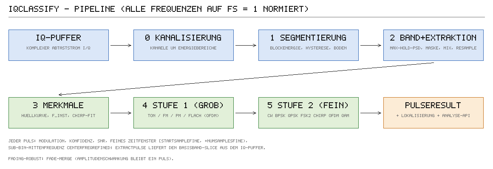
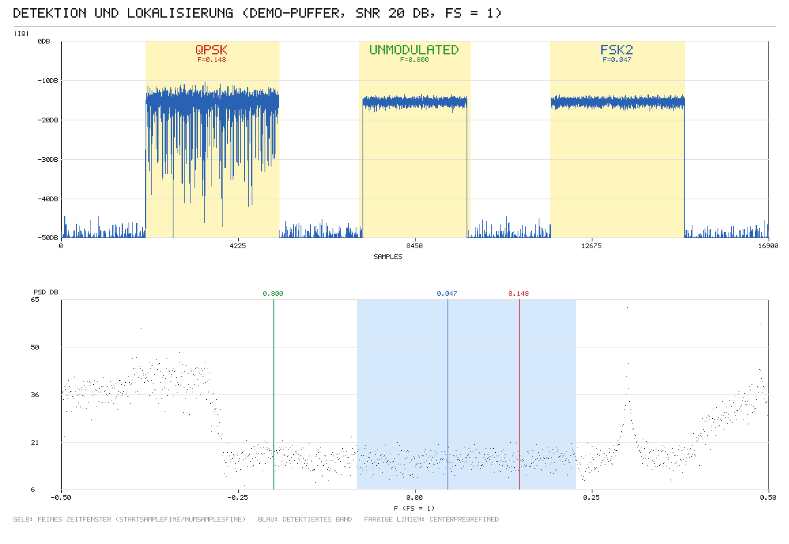
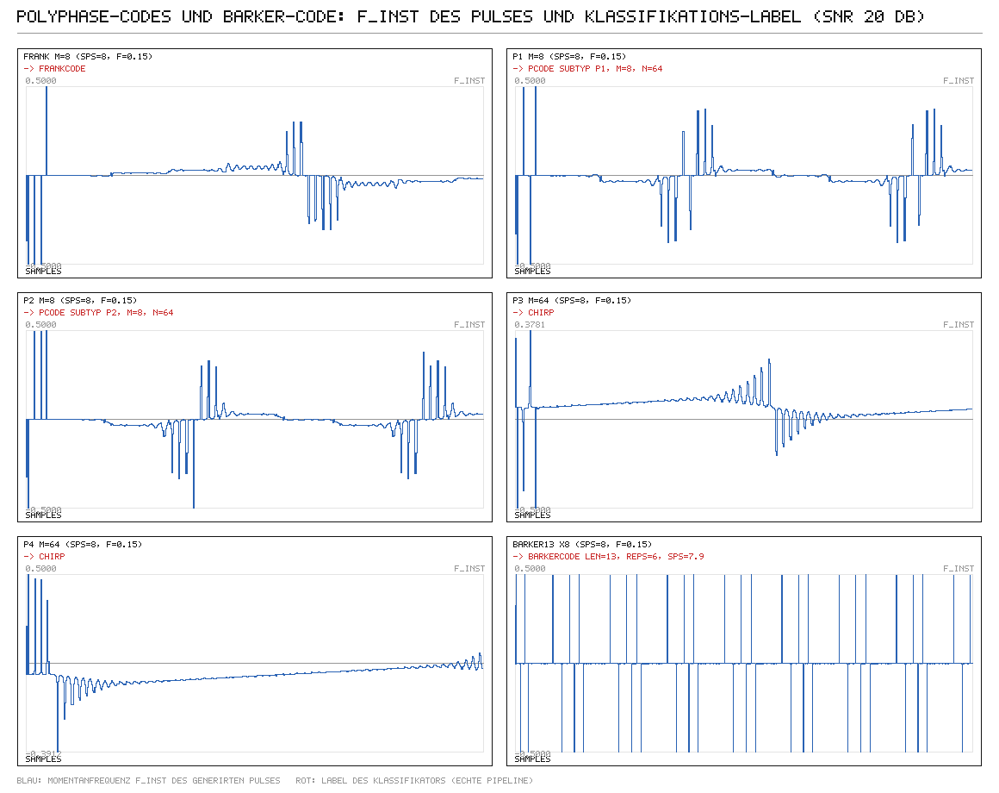
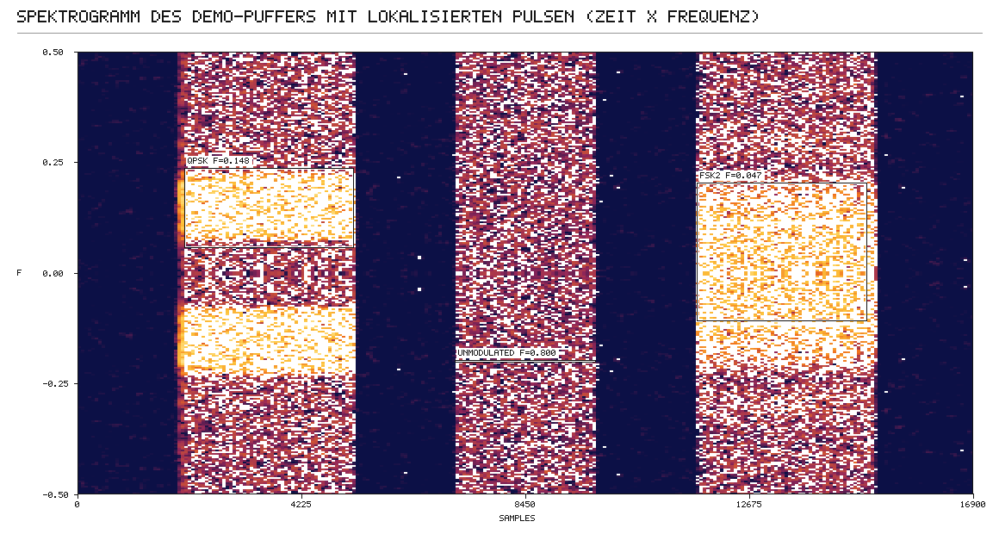

# Klassifizierbare Modulationsarten

IQClassify erkennt in einem IQ-Puffer Pulse und klassifiziert jeden Puls in
zwei Stufen (`ModulationType`):

1. **Stufe 1 (grob, `CoarseClass`)**: Ton, Frequenzmodulation,
   Phasenmodulation, flaechiges Signal (OFDM-Verdacht) — nach SNR,
   Bandbreite, Traegerkohaerenz und PAPR/CV der Hoellkurve.
2. **Stufe 2 (fein, `ModulationType`)**: die eigentliche Modulationsart.

Jeder erkannte Puls wird ausserdem **lokalisiert**: samplegenaue Zeitlage
(`startSampleFine`/`numSamplesFine`) und Sub-Bin-Mittenfrequenz
(`centerFreqRefined`), sodass der Puls im Original-IQ zeitlich und
frequenztechnisch wiedergefunden werden kann (`extractPulse`,
`analyzeChirp`, ...).

## Uebersicht

| `ModulationType` | Bedeutung | Wesentliches Merkmal |
|---|---|---|
| `Unmodulated` | unmodulierter Traeger (CW) | konstante Phase, `|f_inst| ~ 0`, hohe Traegerkohaerenz |
| `BPSK` | Binary Phase Shift Keying | 2 Phasenzustaende (Faltung 2), Kumulante k42 ~ 2 |
| `BarkerCode` | BPSK mit Barker-Folge (7/11/13, wiederholt) | BPSK + Chipfolge matched gegen Barker-Sequenz |
| `QPSK` | Quadrature PSK | 4 Phasenzustaende (Faltung 4), k42 ~ 1 |
| `FSK2` | binäre Frequenzumtastung | 2 dominante `f_inst`-Moden |
| `Chirp` | linearer Frequenzsweep (inkl. P3/P4) | `f_inst` linear (R^2), grosser Hub; P3 gefaltet (Saegezahn) |
| `OFDM` | Orthogonal Frequency Division Multiplexing | zyklischer Praefix (Autokorrelation) oder PAPR + flaches Spektrum |
| `QAM16/64/256` | Quadratur-Amplitudenmodulation | Konstellation auf QAM-Gitter, Kumulante k42 ~ 0.68 |
| `FrankCode` | polyphase Frank-Code, Ordnung M | `f_inst`-Treppe mit M Stufen, jede ein langer Run |
| `PCode` | P1/P2-Code (Lewis-Kretschmer), Ordnung M | eigene `f_inst`-Treppe (M x M Chips), Phasen-Gesetz matched |
| `Unknown` | nicht entscheidbar | zu wenig SNR/Struktur |

## Bilder

Zeit-Huellkurve und Detektionsspektrum eines Demo-Puffers: feine Zeitfenster
(gelb), detektierte Kanaele (blau), Sub-Bin-Mittenfrequenzen (farbige Linien).

Momentanfrequenz (`f_inst`) je eines Frank-, P1-, P2-, P3-, P4- und
Barker13-Pulses (blau) mit dem echten Label der Pipeline (rot). Man sieht die
Treppenstruktur von Frank/P1/P2 (P1/P2 symmetrisch fallend, Frank steigend
im entfalteten Bild), den Saegezahn des gefalteten P3 und den linearen Sweep
von P4.

## Die einzelnen Modulationsarten erklaert

### Unmodulated (CW)
Ein einzelner unmodulierter Traeger: die Phase ist konstant, die
Momentanfrequenz `f_inst` liegt dauerhaft bei ~0 (nach Resttraeger-Entfernung)
und die Traegerkohaerenz ist hoch. Erkannt in Stufe 1 am Ton-Test.

### BPSK / QPSK
Phasenmodulation mit konstanter Huellkurve. Nach Symbol-Timing und
Traeger-Synchronisation (`synchronizePsk`, phasenrichtiger Pulsanfang ohne
Einschwingen) liegen die Symbole auf 2 (BPSK) bzw. 4 (QPSK) Phasenzustaenden:
starke Phasenfaltung (`foldConc`) plus Kumulanten-Lage (`k42` ~ 2 bzw. ~1).
`extractSymbols` liefert die derotierten Symbole als Symbol-Schnittstelle.

### BarkerCode (Feinklasse von BPSK)
Ein BPSK-Puls, dessen Chipfolge einer **Barker-Folge** (Laenge 7, 11 oder 13,
ggf. wiederholt) entspricht. Barker-Folgen haben ideale Autokorrelation
(Nebenzipfel = 1), deshalb eignen sie sich als Radarsync-Code. Erkannt wird
das Barker-Muster direkt auf dem Slice (`barkerMatchSlice`): Symboltakt fein
um die Schaetzung gesucht, Zeichen an den Chip-Mitten gegen alle Rotationen
und beide Vorzeichen der bekannten Folgen getestet (>= 95 % Uebereinstimmung).
Ein repetitiver Barker-Code hat ein Linienspektrum und dieselbe Periodizitaet
wie ein zyklischer Praefix — deshalb wird vor den OFDM-Tests explizit auf
2-PSK-Faltung geprueft (`fold2Gated`), damit Barker nicht als OFDM fehlgeht.
`analyzeBarker` liefert `length`, `code` (+/-1), `repeats`, `sps`,
Traegerfrequenz und SNR. Zufaelliger BPSK-Puls wird nie als BarkerCode
ausgegeben (Negativtest in Szenario 23).

### FSK2
Zwei Traegerfrequenzen, zwischen denen umgetastet wird: `f_inst` hat zwei
dominante Moden. Symbol-Takt aus den Umschaltspitzen von `|Delta f_inst|`
(zyklisches Spektrum), Symbole als Frequenzfolge in `extractSymbols`
(`symbolFreqs`, `fskTone`).

### Chirp (inkl. P3/P4-Codes)
Linearer Frequenzsweep: `f_inst` steigt (oder faellt) linear ueber den Puls
(env^2-gewichteter Fit, R^2). Grosser Hub relativ zur Bandbreite.
**P3/P4-Codes** (Laenge M, Chip-Phase ~ pi*m^2/M) sind Chirps; P3 erscheint
durch die Faltung am Chip-Rand (Phasensprung > pi pro Chip) als **Saegezahn**
in `f_inst` und wird ueber den gefalteten Chirp-Test erkannt (grosser Abfall
an innerer Stelle, beide Seiten linear mit gleichsinniger Steigung).
`analyzeChirp` liefert Startfrequenz, Rate, Bandbreite, Richtung.

### OFDM
Viele orthogonale Untertraeger: im ZeitbereichAehnlichkeit durch den
zyklischen Praefix (Autokorrelationsspitze bei tau = Nutzdatenlaenge) oder
als Fallback fenstergemitteltes PAPR + glaettetes In-Band-Spektrum.

### QAM16 / QAM64 / QAM256
Amplituden- UND phasenmoduliert: die Symbole bilden ein quadratisches
QAM-Gitter. Ordnung ueber Drehwinkel-Suche der Level-Abstaende plus Kumulante
`k42` (~0.68, SNR-korrigiert).

### FrankCode (polyphase Radar-Code)
Der Frank-Code der Ordnung M hat N = M^2 Chips; Chip (i,j) traegt die Phase
`2*pi*i*j/M`. Dadurch ist `f_inst` eine **Treppe mit M Stufen**: innerhalb
Zeile i ist die Frequenz konstant (`i/(M*sps)`), jede Stufe dauert M Chips.
Erkannt wird die Treppe im Histogramm der gefilterten `f_inst` (gleichmaessige
Stufen-Abstaende, R^2 der Stufen-Mitten gegen den Index, lange Runs pro
Stufe). Abgrenzung: Chirp (kontinuierlicher Sweep), FSK2 (nur 2 Moden),
PSK (kein Sweep). `analyzeFrank` liefert Ordnung M, N, Chip-Rate, R^2 und die
N Code-Phasen.

### PCode (P1/P2, anknuepfend an Frank)
P1/P2 (Lewis-Kretschmer) haben ebenfalls M x M Chips, aber das Phasen-Gesetz
`-(pi/M)(M-2i)(M-2j)` (P2: `-(pi/M)(M-2i)(M-2j-1)`). Ihre `f_inst`-Treppe
ist symmetrisch und faellt im entfalteten Bild — sie kann durch die
Impulsformung so verschmiert sein, dass das Stufen-Histogramm sie nicht
findet. Deshalb entscheidet ein **Matched Filter der Phasen-Gesetze**
(`polyLawMf`): das Slice wird gleitend mit dem Chip-Template von Frank/P1/P2
korreliert (Chip-Rate fein um `n/M^2` gesucht); P1/P2 gewinnen nur bei
klarem Score-Vorsprung gegen das Frank-Gesetz (Ratio > 1.15, im Fallback ohne
Treppe zusaetzlich absoluter Score > 0.10 und Ratio > 1.8 — so bleibt FSK2
FSK2). `analyzePcode` liefert Subtyp (1 = P1, 2 = P2), Ordnung M, N = M^2,
Chip-Rate, R^2, lawErr und die N Code-Phasen. **P3/P4** sind Chirp-artig und
werden als `Chirp` klassifiziert (siehe oben).

## Grenzen (dokumentiert)

- P3 erscheint durch Chip-Rand-Faltung als Saegezahn in `f_inst` und wird
  ueber den gefalteten Chirp erkannt; bei sehr kleiner Ordnung oder niedrigem
  SNR kann die Zuordnung kippen.
- Die P1/P2-Unterscheidung (Subtyp) ist bei 15 dB SNR nicht zuverlaessig;
  bei 20 dB wird sie in der Testsuite ueberprueft.
- Barker7/11-Pulse kurzer Laenge koennen bei wenigen Wiederholungen durch
  das Linienspektrum in mehrere schmale Kanaele zerfallen; mit genuegend
  Wiederholungen (x5..x8) wird der Puls als ein `BarkerCode` erkannt.
- Frank-Codes hoeherer Ordnung koennen bei niedrigem SNR in Subbaender
  zerfallen (dann mehrere Pulse).

## Tests

Die Szenarien 21 (Frank), 22 (P-Codes P1..P4) und 23 (Barker) in
`tests/test_main.cpp` verankern Erkennung, Frequenzlage, Subtyp/Ordnung und
die Analyse-APIs; die Negativtests stellen sicher, dass FSK2/Chirp/BPSK nicht
als PCode/BarkerCode durchgehen. Aktueller Stand: 162/162 Tests bestanden.
